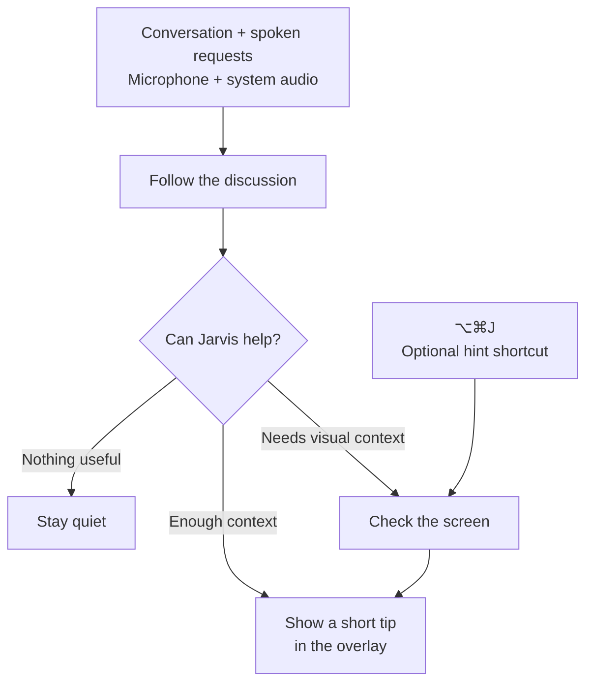

# Jarvis

[English](./README.md) · [简体中文](./README.zh-CN.md)

**Your voice-only AI agent. Like Jarvis for Tony Stark.**

[](https://github.com/JINGBANZ/jarvis/releases/latest/download/Jarvis.dmg)
[](https://t.me/+-FDYU99oXTBlZmQx)

Jarvis is an experimental, open-source AI agent built around [spoken
interaction](./wiki/architecture.md#1-vision). Think out loud or ask a question: it listens to both
sides of the conversation, checks your screen when useful, and offers timely help in a private
on-screen overlay. Its current focus is coaching technical conversations, including behavioral,
system-design, and coding questions. **No text input. No prompt box.**

## Install Jarvis

Currently available for macOS only. Requires an Apple silicon Mac running macOS 14.2 or later.

[**Download the macOS version**](https://github.com/JINGBANZ/jarvis/releases/latest/download/Jarvis.dmg)

Open Jarvis from **Applications**, configure its providers in **Settings**, then select **Start
Jarvis**. macOS will request the permissions Jarvis needs.

## How it works



### Features

- **Voice-only interaction:** talk naturally without typing prompts.
- **Two-sided listening:** follow both your microphone and system audio to keep the conversation
  in context.
- **Proactive coaching:** get help when there is something useful to add; otherwise, Jarvis stays
  quiet.
- **Screen-aware hints:** use visual context when needed, or press **⌥⌘J** during a session for
  an immediate hint.
- **Private overlay:** read concise tips without leaving the conversation.
- **Technical-conversation support:** get coaching for behavioral, system-design, and coding
  questions.

## Developer quick start

Requires Swift 6 and the macOS [Command Line Tools](./wiki/build-and-run.md#toolchain).

```bash
git clone https://github.com/JINGBANZ/jarvis.git
cd jarvis
./scripts/build-app.sh --run
```

See [Build and run](./wiki/build-and-run.md) for signing, permissions, and troubleshooting.

## Community

Join our [Telegram community](https://t.me/+-FDYU99oXTBlZmQx) to share your thoughts, ask questions,
and help shape Jarvis. Everyone is welcome!

## Project links

[Wiki](./wiki/index.md) · [Contributing](./CONTRIBUTING.md) · [Security](./SECURITY.md) ·
[License](./LICENSE) · [Third-party notices](./THIRD_PARTY_NOTICES.md)

## Privacy

- Raw audio and the rolling live transcript are not archived locally.
- Jarvis keeps bounded, owner-only session records of finalized speech, coaching actions,
  diagnostics, provider traffic, and screenshots it viewed.
- Selected remote providers receive the audio, text, or screenshots their configured role needs.
  OpenAI coaching requests currently enable server-side storage for debugging.

See [Privacy and security](./wiki/sandbox.md) for the complete egress and retention model.
