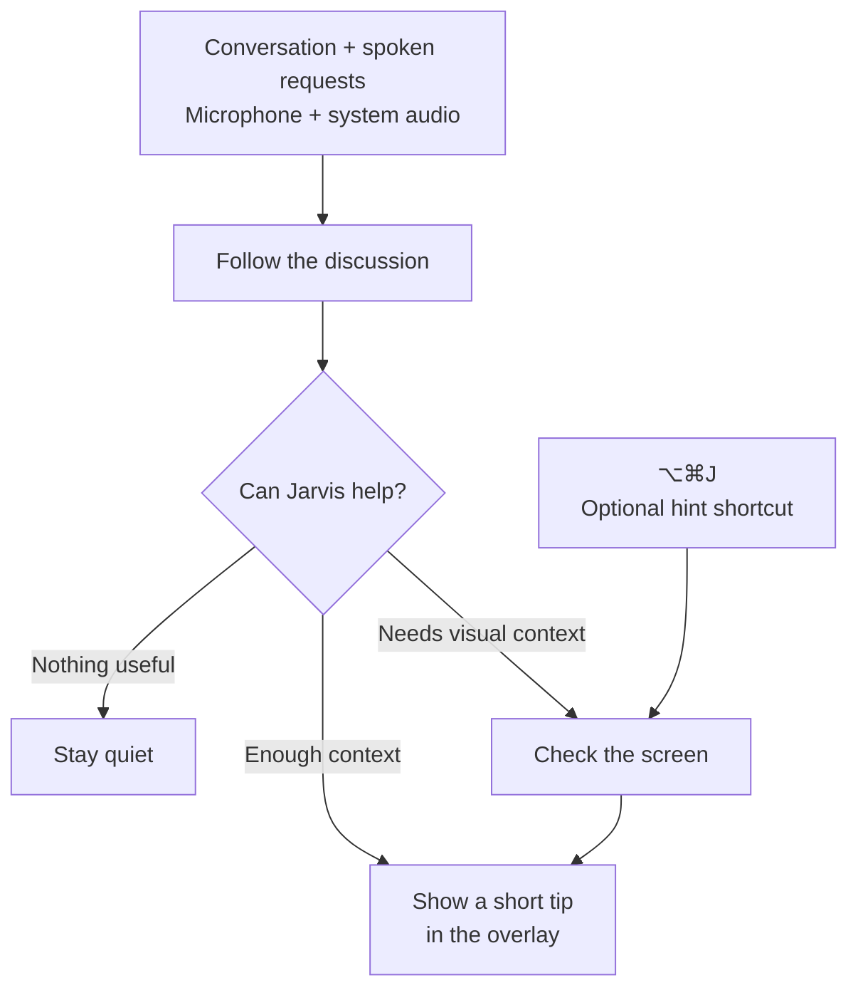

<h1 align="center">Jarvis</h1>

<p align="center">
  <a href="./README.md">English</a> · <a href="./README.zh-CN.md">简体中文</a>
</p>

<p align="center">
  <a href="https://github.com/JINGBANZ/jarvis/releases/latest/download/Jarvis.dmg"></a>
  <a href="https://t.me/+-FDYU99oXTBlZmQx"></a>
  <br>
  <sub>Apple silicon · macOS 14.2 or later</sub>
</p>

**Your voice-only AI agent. Like Jarvis for Tony Stark.** Think out loud, ask a question, or just
keep the conversation going. Jarvis listens to both sides, checks your screen when helpful, and
offers a quiet nudge in an on-screen overlay so you can stay focused on the conversation.
Today, it helps you work through behavioral interviews, system-design discussions, and coding
questions. No typing, no prompt box—just talk naturally.

## How it works



### Features

- **Just talk:** [voice-only interaction](./wiki/architecture.md#1-vision) keeps your attention on
  the conversation, with no prompts to type.
- **Both sides of the story:** Jarvis listens through your microphone and system audio to follow
  the discussion.
- **Help at the right moment:** get a useful suggestion when you need it. When there is nothing
  to add, Jarvis stays quiet.
- **Context from your screen:** Jarvis checks the screen when needed. Want a hint right away?
  Press **⌥⌘J** during a session.
- **Tips close at hand:** read short suggestions in an on-screen overlay without leaving the
  conversation.
- **Support as you think:** work through behavioral, system-design, and coding questions with
  a little guidance along the way.

## Developer quick start

Use an Apple silicon Mac with macOS 14.2+, Swift 6, Python 3, and the macOS
[Command Line Tools](./wiki/build-and-run.md#toolchain), with a logged-in macOS GUI session.

```bash
git clone https://github.com/JINGBANZ/jarvis.git
cd jarvis
./scripts/build-app.sh --run
```

See [Build and run](./wiki/build-and-run.md) for signing, permissions, and troubleshooting.

## Community

Come say hello in our [Telegram community](https://t.me/+-FDYU99oXTBlZmQx). Share an idea, ask a
question, or tell us how Jarvis fits into your day. We'd love to hear from you.

## Project links

[Wiki](./wiki/index.md) · [Contributing](./CONTRIBUTING.md) · [Security](./SECURITY.md) ·
[License](./LICENSE) · [Third-party notices](./THIRD_PARTY_NOTICES.md)

## Privacy

- Raw audio and the rolling live transcript are not archived locally.
- Jarvis keeps bounded, owner-only session records of finalized speech, coaching actions,
  diagnostics, provider traffic, and screenshots it viewed.
- Selected remote providers receive the audio, text, or screenshots their configured role needs.
- Optional provider conversation storage is off by default. Direct OpenAI coaching requests follow
  the **Save conversations with AI providers** setting in **Settings → General → Privacy**;
  other provider retention policies still apply.
- Overlay capture exclusion is best-effort; some recording or screen-sharing paths may show it.
  See the [capture guidance](./wiki/overlay-invisibility.md).

See [Privacy and security](./wiki/sandbox.md) for the complete egress and retention model.
