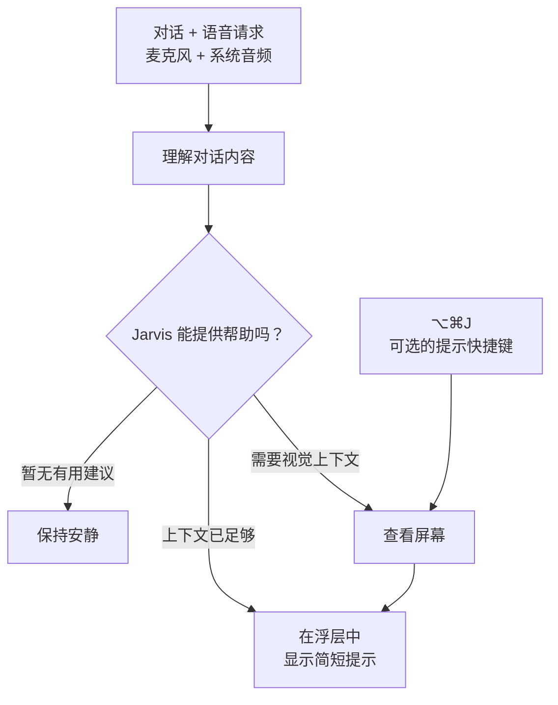

# Jarvis

[English](./README.md) · [简体中文](./README.zh-CN.md)

**你的纯语音 AI 助手，就像托尼·斯塔克的贾维斯。**

[](https://github.com/JINGBANZ/jarvis/releases/latest/download/Jarvis.dmg)
[](https://t.me/+-FDYU99oXTBlZmQx)

Jarvis 是一款以[语音交互](./wiki/architecture.md#1-vision)为核心的实验性开源 AI 助手。说出你的想法，或直接提问：它会聆听对话双方的内容，在需要时查看屏幕，并通过私密的屏幕浮层及时提供帮助。目前，Jarvis 专注于技术交流辅导，涵盖行为面试、系统设计和编程问题。**无需打字，没有提示词输入框。**

## 安装 Jarvis

目前仅支持 macOS，需要搭载 Apple 芯片、运行 macOS 14.2 或更高版本的 Mac。

[**下载 macOS 版本**](https://github.com/JINGBANZ/jarvis/releases/latest/download/Jarvis.dmg)

从 **Applications（应用程序）** 打开 Jarvis，在 **Settings（设置）** 中配置服务提供商，然后选择 **Start Jarvis（启动 Jarvis）**。macOS 会请求 Jarvis 所需的权限。

## 工作原理



### 功能

- **纯语音交互：** 自然地说话，无需输入提示词。
- **聆听对话双方：** 同时接收麦克风和系统音频，理解完整的对话上下文。
- **主动辅导：** 在能提供有用建议时主动帮助，其余时间保持安静。
- **结合屏幕的提示：** 按需获取视觉上下文，也可以在会话中按 **⌥⌘J** 立即获取提示。
- **私密浮层：** 在不离开当前对话的情况下查看简短建议。
- **技术交流辅导：** 支持行为面试、系统设计和编程问题。

## 开发者快速开始

需要 Swift 6 和 macOS [命令行工具](./wiki/build-and-run.md#toolchain)。

```bash
git clone https://github.com/JINGBANZ/jarvis.git
cd jarvis
./scripts/build-app.sh --run
```

签名、权限和故障排查说明请参阅[构建与运行](./wiki/build-and-run.md)。

## 社区

欢迎加入我们的 [Telegram 社区](https://t.me/+-FDYU99oXTBlZmQx)，分享想法、提出问题，一起完善 Jarvis。

## 项目链接

[Wiki](./wiki/index.md) · [贡献指南](./CONTRIBUTING.md) · [安全政策](./SECURITY.md) ·
[许可证](./LICENSE) · [第三方声明](./THIRD_PARTY_NOTICES.md)

## 隐私

- 原始音频和滚动更新的实时转录不会在本地归档。
- Jarvis 会保留有容量限制、仅当前用户可访问的会话记录，包括已定稿的转录、辅导操作、诊断信息、与服务提供商的通信记录，以及它查看过的屏幕截图。
- 所选的远程服务提供商会接收其配置角色所需的音频、文本或屏幕截图。目前，OpenAI 辅导请求启用了服务端存储，用于调试。

完整的数据外传与保留机制请参阅[隐私与安全](./wiki/sandbox.md)。
