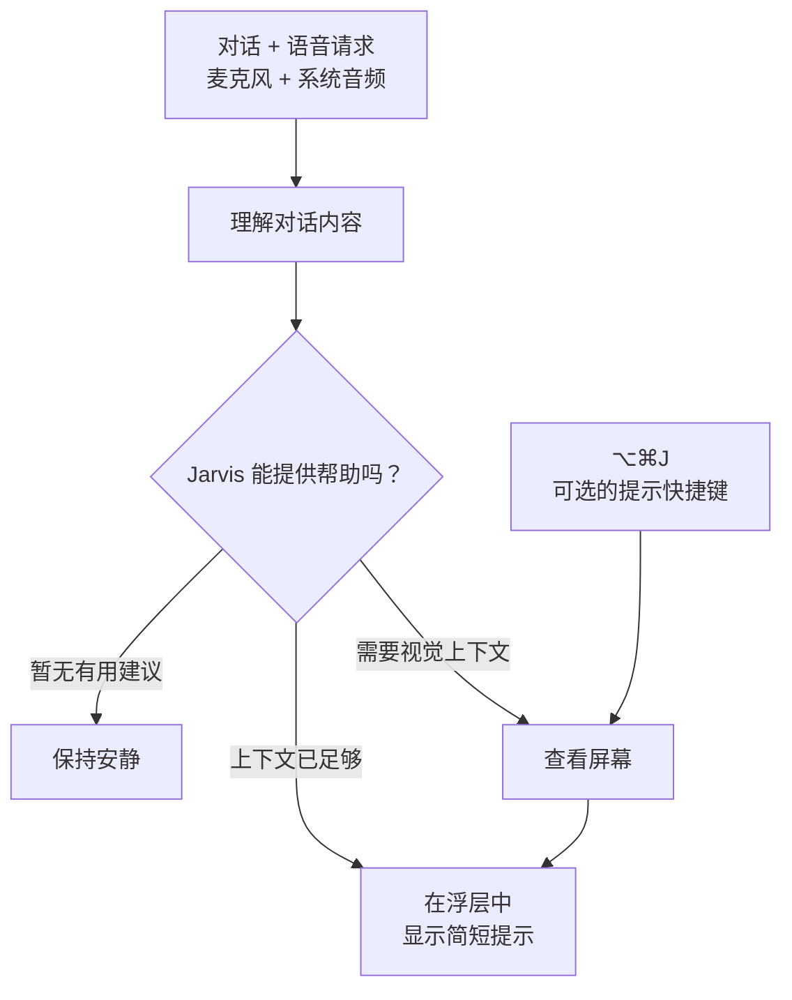

<h1 align="center">Jarvis</h1>

<p align="center">
  <a href="./README.md">English</a> · <a href="./README.zh-CN.md">简体中文</a>
</p>

<p align="center">
  <a href="https://github.com/JINGBANZ/jarvis/releases/latest/download/Jarvis.dmg"></a>
  <a href="https://t.me/+-FDYU99oXTBlZmQx"></a>
  <br>
  <sub>Apple 芯片 · macOS 14.2 或更高版本</sub>
</p>

**你的纯语音 AI 助手，就像托尼·斯塔克的贾维斯。** 说出你的想法，随口问个问题，或是继续眼前的对话。Jarvis 会聆听双方的交流，在有帮助时查看屏幕，通过私密的屏幕浮层轻轻提醒，让你专注于对话本身。目前，它可以陪你梳理行为面试、系统设计和编程问题。无需打字，也没有提示词输入框，自然地说话就好。

## 工作原理



### 功能

- **自然开口就好：** [纯语音交互](./wiki/architecture.md#1-vision)，无需输入提示词，把注意力留给对话。
- **听懂双方的交流：** 通过麦克风和系统音频，跟上对话的来龙去脉。
- **恰到好处的帮助：** 在需要时给出有用的建议，没有要补充的内容时就安静陪伴。
- **结合屏幕理解问题：** 按需查看屏幕。想马上获得提示？在会话中按 **⌥⌘J** 即可。
- **随手可见的建议：** 在私密浮层中查看简短提示，无需离开当前对话。
- **陪你梳理思路：** 从行为面试到系统设计和编程问题，在思考的过程中提供一点指引。

## 开发者快速开始

需要 Apple 芯片 Mac、macOS 14.2 或更高版本、Swift 6、Python 3 和 macOS
[命令行工具](./wiki/build-and-run.md#toolchain)，并保持 macOS 图形会话登录。
无需连接实体显示器；在无显示器的 Mac 上，共用测试显示器充当主屏幕，并在测试结束后保留。

```bash
git clone https://github.com/JINGBANZ/jarvis.git
cd jarvis
swift build && ./scripts/run-tests.sh
./scripts/build-app.sh --run
```

测试显示器会自动初始化。请完成[开发环境设置](./CONTRIBUTING.md#developer-setup)，
每次创建 PR 前运行完整的本地 Gate，并附上通过的输出。再次测试前请退出 `Jarvis Dev`。
离线 Gate 不需要 API 密钥或录屏、录音权限。

签名、权限和故障排查说明请参阅[构建与运行](./wiki/build-and-run.md)。

## 社区

欢迎来 [Telegram 社区](https://t.me/+-FDYU99oXTBlZmQx)打个招呼。分享一个想法，问个问题，或聊聊你平时如何使用 Jarvis。我们很期待听到你的声音。

## 项目链接

[Wiki](./wiki/index.md) · [贡献指南](./CONTRIBUTING.md) · [安全政策](./SECURITY.md) ·
[许可证](./LICENSE) · [第三方声明](./THIRD_PARTY_NOTICES.md)

## 隐私

- 原始音频和滚动更新的实时转录不会在本地归档。
- Jarvis 会保留有容量限制、仅当前用户可访问的会话记录，包括已定稿的转录、辅导操作、诊断信息、与服务提供商的通信记录，以及它查看过的屏幕截图。
- 所选的远程服务提供商会接收其配置角色所需的音频、文本或屏幕截图。目前，OpenAI 辅导请求启用了服务端存储，用于调试。

完整的数据外传与保留机制请参阅[隐私与安全](./wiki/sandbox.md)。
