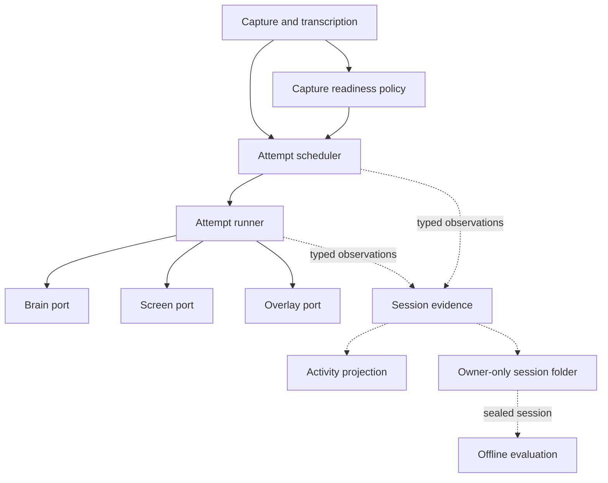

# Lean Coaching Core

The coaching kernel contains only policy and injected ports that can affect a coaching outcome.
Optional evidence and maintenance work cannot decide whether Jarvis hears, reasons, captures, or
delivers a tip. This page defines that dependency boundary; the runtime behavior lives in
[architecture.md](./architecture.md), and the evidence contract in
[session-audit.md](./session-audit.md).

## Critical lane and optional work

From finalized transcript admission through overlay delivery, coaching depends on deterministic
in-memory policy and explicitly injected brain, screen, and output ports. Producers may submit
observations through narrow, nonthrowing evidence ports, but cannot await persistence or read its
health to decide a coaching outcome.

Evidence has one uniform best-effort loss contract. Capacity pressure or persistence failure may
lose Activity, diagnostics, or evaluator records; it cannot lose transcript state, committed coaching
history, route state, or accepted overlay delivery. Priority classes, reserved evidence capacity,
writer retries, and backpressure require a separate product-contract decision. The exact admission,
completeness, attribution, and Stop/Start/Quit rules belong to
[Session Evidence](./session-audit.md).

## State ownership

| Owner | Responsibility |
|---|---|
| [`CoachDriver`](../Sources/JarvisCore/Coach/CoachDriver.swift) | Trigger coalescing, transcription settlement, the single-flight slot, route state, and cycle recovery. |
| [`CoachAttemptRunner`](../Sources/JarvisCore/Coach/CoachAttemptRunner.swift) | One snapshotted target's bounded tool loop, overlay delivery, history commit, and cancellable background compaction. |
| [`CoachTranscriptLedger`](../Sources/JarvisCore/Coach/CoachAttemptRunner.swift) | Monotonic committed transcript boundary shared by scheduler and runner, without either acquiring the other's lock. |
| [`AppDelegate`](../Sources/JarvisApp/App/AppDelegate.swift) | Start validation and preflight, readiness presentation, menu, shortcuts, and Settings composition. |
| [`SessionComposition`](../Sources/JarvisApp/App/SessionComposition.swift) | Capture/transcription composition, one live session's readiness effects, and teardown. |
| [`BrainComposition`](../Sources/JarvisApp/App/BrainComposition.swift) | Provider preflight, route construction, and between-attempt reapplication of brain preferences and credentials. |
| [`SessionArtifacts`](../Sources/JarvisApp/App/SessionArtifacts.swift) | Session directory and evidence ownership, Activity wiring, asynchronous retention, and protection of closing sessions. |

The scheduler and runner have separate locks for separate state. The transcript ledger is a leaf
lock; neither half holds the other's lock. Composition builds concrete clients outside Core and
injects ports into the kernel. The [ordered route policy](./architecture.md#ordered-provider-route)
defines fresh-attempt retries and cycle recovery; adapter reconnect is a separate transcription
contract.

## Immutable plan boundaries

[`SessionPlan`](../Sources/JarvisCore/Config/SessionPlan.swift) freezes the screen selection under a
revision identity. Preferences are read at Start or an explicit Settings revision boundary; an
attempt snapshots one plan and retains it through every screen continuation. A mid-attempt edit
applies to the next attempt. Capture adapters receive the selection as a value and never read the
preference store themselves.

The route and credentials are frozen separately through `ConfiguredBrainRoute`. Combining those
values into another control-plane object adds no boundary: the existing snapshots already keep
storage reads outside attempts. Runtime health does not rewrite saved preferences or create screen
plan revisions.

## Capture heartbeat

[`CaptureHeartbeat`](../Sources/JarvisCore/Diagnostics/CaptureHeartbeat.swift) is content-free frame
progress from `AudioContinuityWitness`. `CaptureHeartbeatGate` promotes first progress and recovery
from a stall without keeping a second counter. Positive samples count as progress even when they
contain digital silence; amplitude does not prove capture health or permission.

[`RealtimeContinuityReporter`](../Sources/JarvisApp/Capture/RealtimeContinuityReporter.swift) fans the
observation out to two one-way consumers: the critical `CaptureReadinessMonitor` first, then an
optional diagnostic copy through `jlog`. The critical branch never reads evidence. Missing frames
can keep readiness pending, degrade system audio, or stop an unusable microphone session, regardless
of whether the diagnostic copy survives.

## Offline work and adapter boundaries

History compaction runs outside the active attempt and is preemptible. Failed or stale summaries
leave full history intact; the validation and context rewrite boundary are defined in
[Models and APIs](./architecture.md#models-and-apis). Retention scans and deletion run asynchronously
after session creation, preserving the current and still-closing directories.

`JarvisEvaluation` reads sealed evidence and is shared by Activity and `EvalPrep`; Core cannot import
it. `JarvisBrainProviders` owns concrete brain transports and evaluator CLI processes.
`JarvisScreenCapture` owns OS capture, transient-file cleanup, and the session-local cleanup-failure
latch. These adapters depend inward on Core's domain contracts and use `JarvisProcess` for process
launching. [Package.swift](../Package.swift) is authoritative for target dependencies; the
[test ownership contract](./test-command-ownership.md#whole-commands-and-process-roles) defines debug
launcher injection.

A target is justified by a compiler-enforced boundary, an isolated test boundary, or another
executable consumer. File or line count alone does not justify extraction.

## Verification

[`check-coaching-kernel.sh`](../scripts/check-coaching-kernel.sh) guards the kernel against concrete
persistence, provider transports, process launching, and preference reads. The coaching parity
harness compares calls, transitions, outcomes, and overlay output under absent, healthy, blocked,
full, oversize, and failing evidence. `CaptureHeartbeatTests` independently verifies that evidence
pressure cannot change readiness, degradation, or stop decisions. `SessionPlanTests` verifies that
an in-flight attempt retains its revision.

The repository [Gate](../AGENTS.md#commands) runs these checks. OS-bound session composition and
presentation require the [signed-app checks](./live-e2e-tests.md#what-stays-outside-the-command).
The review question is: **Can this dependency change or delay a coaching outcome?** Optional work
may observe the critical lane; it cannot become a prerequisite for it.
